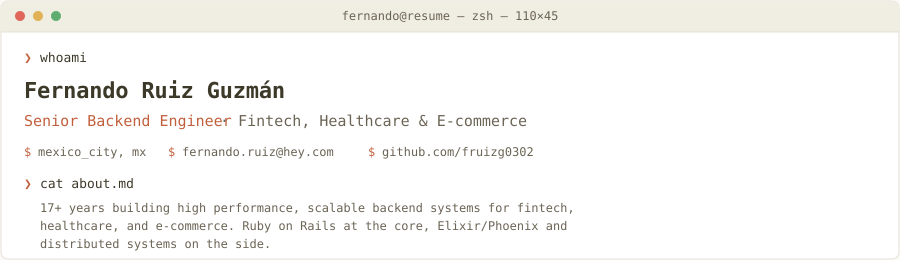

  

 

❯ **ls ./stack --sort=experience**

`Ruby / Rails · 15+ yrs`&nbsp; `PostgreSQL · 15+ yrs`&nbsp; `REST APIs · 15+ yrs`
`CI/CD · 10 yrs`&nbsp; `Elixir / Phoenix · 7 yrs`&nbsp; `Docker · 7 yrs`
`AWS · 5 yrs`&nbsp; `GraphQL · 4 yrs`&nbsp; `Distributed Sys. · 3–4 yrs`
`Kubernetes · 2 yrs`&nbsp; `DataDog · 1 yr`&nbsp; `Kafka / gRPC · 1 yr`

 

❯ **git log --author=fernando --stat experience/ -n 3**

**Engineer II** @ SimplePractice &nbsp;·&nbsp; `06/2025 – Present`
· Backend engineer on high performance, scalable systems for healthcare practice management
· Building resilient infrastructure with Ember.js and Ruby on Rails for critical healthcare delivery

**Senior Software Engineer** @ Bugcrowd (via Encora) &nbsp;·&nbsp; `06/2024 – 05/2025`
· Developed features across the API and integrations team using React, Ruby, and Rails
· Built and maintained integrations connecting Bugcrowd's platform with partner and customer systems

**Senior Software Engineer** @ Acima &nbsp;·&nbsp; `04/2023 – 05/2024`
· Built scalable fintech backend services for lease-to-own payment solutions, incorporating Kafka for event streaming
· Worked with Kubernetes for container orchestration across services

 

❯ **cat contact.txt**

`$` mexico_city, mx &nbsp;&nbsp; `$` [fernando.ruiz@hey.com](mailto:fernando.ruiz@hey.com) &nbsp;&nbsp; `$` [github.com/fruizg0302](https://github.com/fruizg0302)

 

● process exited (0)
